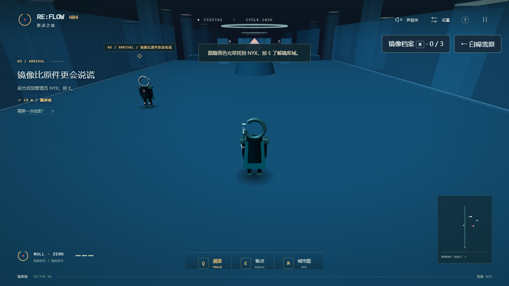
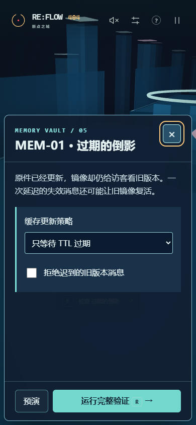

# RE:FLOW 404 · 断点之城｜新手图文玩法

你扮演头部有缺口圆环的「零号」，帮 MIRA 找回被列车跳过的 B 站，让脉冲炉的晴雨与进位重新运转，到千线程解开两条生命线的等待，再把最后一封求救信送过白噪雪原。

**这篇说明可以直接发给第一次玩的朋友。不需要写代码：走到目标旁边，扫描，再调整工作台里的规则。** 当前 V6.4 开放 **5 / 8 座城市**：指针港、脉冲炉、千线程、雨线城 · 白噪雪原、镜库城。第五城包含三面镜像终端、三组有限情景回归、实体光桥与全城综合回归；其余三城为后续规划。




[打开游戏](#start) · [关键按键](#keys) · [第一城图文](#walkthrough) · [第二城图文](#forge) · [第三城六关图文](#thread) · [第四城八关与风暴投递](#snow) · [第五城镜库城](#mirror) · [天气怎么玩](#weather) · [手机操作](#touch) · [卡住怎么办](#help) · [开发与验收](#development)

<a id="start"></a>

## 先把游戏打开

### 已经有人帮你启动了游戏

在**运行游戏服务的那台电脑**上，打开 [本地正式预览：http://127.0.0.1:5387/](http://127.0.0.1:5387/)。

**发给朋友时请注意：`127.0.0.1` 指的是打开链接的那个人自己的电脑。** 把这个链接发给另一台电脑，并不能让对方访问作者的电脑。朋友可以按下面的方法在自己电脑启动，或使用维护者另行提供的公开试玩地址。

当前的[在线部署地址](https://reflow-404-breakpoint-city-1024.amber-haven-4753.chatgpt.site)仍是**仅所有者可访问的私有站点**。朋友遇到无权限或 403 时，可先按本地启动步骤体验。

### 第一次在自己电脑启动

1. 准备 **Node.js 24 或更高版本**。
2. 在本仓库页面点击绿色 **Code → Download ZIP**，解压。
3. 进入能看见 `package.json` 的文件夹，打开终端。Windows 可以在该文件夹的地址栏输入 `cmd` 后回车。
4. 依次执行：

```sh
npm ci
npm run dev -- --host 127.0.0.1 --port 5386 --strictPort
```

5. 保持终端运行，在浏览器打开 **[http://127.0.0.1:5386/](http://127.0.0.1:5386/)**。

首次下载依赖需要联网。关闭运行服务的终端后，本地链接也会停止响应。请通过上述网页地址进入游戏。

<a id="keys"></a>

## 先记住这几个操作

**最常用的是：WASD 走路 → Q 扫描 → E 交互 → 修改方案 → R 验证。**

| 你想做什么 | 电脑上怎么操作 |
| --- | --- |
| 向前、向左、向后、向右走 | 按住 **W、A、S、D**；方向键也可以 |
| 看向别的方向 | **按住鼠标右键并拖动**；只移动鼠标不会转镜头 |
| 跑快一点 | 移动时按住 **Shift** |
| 跳一下 | **空格 Space** |
| 看见异常的线索 | 靠近目标后按 **Q**，或点击底部「溯源」 |
| 对话、打开编辑面板、登车 | 看到画面中间的 **E 提示**后按 **E**，或直接点击提示 |
| 按当前方案实际运行一次 | 在编辑面板中按 **R**，或点金色「重放并验证」 |
| 看地图 / 任务册 | **M / Tab**，或点击右下角小地图；千线程和白噪雪原先打开任务册，册底可进城际地图 |
| 切换天气 | 右上角天气按钮，或按 **T**；前三城晴雨，第四城晴霁 / 降雪 / 暴风雪 |
| 雪原稳身抗风 | **按住 F**，或点「**稳身**」按钮切换；移动会变慢，横风推移大幅减少 |
| 退出编辑 / 暂停 | **Esc**；正在编辑时先退出编辑，再按一次可打开暂停菜单 |
| 打开说明、声音和画面设置 | 右上角 **?、喇叭、设置**按钮 |

> **预演 / 检测是先看看结果；真正完成修复，需要点击金色验证按钮。** 指针港的断点会冻结局部时间。脉冲炉的天气工作台会持续蓄能、漏电与散热；打开暂停菜单才会冻结设备。

<details>
<summary><strong>只想先过关？点这里看最短操作清单（含答案）</strong></summary>

1. 首页点「进入指针港」。
2. 向前走到左侧 MIRA 附近，出现「E 与 MIRA 对话」后按 E。持续点「继续」或按 E，直到对话结束、获得因果织针。
3. 再向前走到「Q-01 / 事件失序」附近，按 **Q，再按 E**。
4. 把「让旅客离开」移到第一位，排成 **让旅客离开 → 移除旧站台 → 保存生还记录**。点「重放并验证」。
5. 等维修通道展开，沿桥和长坡向前走到 **A 站**，再按 **Q、E**。
6. 在面板上排「源节点」选 **A**，下排「连接到目标站」选 **B**。确认中间显示 **A.next → B**，再点「重放并验证」。
7. 修复镜头结束后，在 **A 站列车旁再按一次 E 登车**。等列车抵达终点，出现 **200 OK** 即完成第一城。
8. 点「**乘城际列车出发**」，进入脉冲炉。向前找到 **K-13**，按 E；再靠近集电台按 Q、E。
9. 选择 **晴天**，让隔离闸保持打开；充到 **80% 以上**后，点「隔离闸开着 · 点此关闭」。
10. 再选 **雨天**，等温度降到 **35°C 以下**，点「验证并接入」。
11. 沿展开的通道和两段坡道上行，到塔底按 Q、E。选择 **CARRY / 产生进位**，点「重放并验证」。
12. 向前走上圆形升降台，按 E 乘梯。到塔顶出现第二次 **200 OK**，完成第二城。
13. 点第二城结算中的「**下一站 · 千线程**」，入城后与 **IRIS** 对话。沿中央灯带逐层上行，每台异常设备都先 **Q、E**。
14. **交叉桥**：两车都设「先 A，再 B」（都先 B 也可以），勾选「释放旧现场并受控重启」，验证。
15. **等不到的电车**：老化间隔设 **8**，勾选「同优先级时先来先服务」，验证。
16. **消失的那一票**：选择「**原子提交**」或「**互斥区**」，验证。
17. **内存走廊**：勾选「命中后移到最近端」，换出选「**最久未更新端**」，验证。
18. 到最北端 **WAIT-FOR-∞** 终端按 **E** 做综合回归，镜头结束后在同一站台**再按 E 登车**。约 18 秒后完成第三城。
19. 想收齐故事，去电车站左侧完成 **OS-S1：WHILE / 醒来重新检查**；去售票台右侧完成 **OS-S2：CAS / 比较并取得**。通关后仍能回来补齐。
20. 第三城结算点「**下一站 · 白噪雪原**」，与 KESTREL 对话。沿橙旗前进，每台设备先 **Q → E**。第四城每次修复都要点「**运行完整验证**」，预演不会提交。
21. **WF-02**：朝向「随风转向」，风闸「强阵风时关闭」，阈值 **9**，除冰「恒温除冰 · 按需启动」。
22. **NET-01**：设 **A→C、B→D、C→E、E→D**，**TTL=4**，勾选「健康检查与备用下一跳」。
23. **NET-02**：开启「保留超时重传」，去重选「会话 + 序号」，开启「重复副本也返回 ACK」。
24. **NET-03**：窗口 **12**，勾选「成功加一、丢包减半」和「失败后退避」。
25. **NET-04**：选「Lamport 逻辑时间」「节点编号」，勾选「收齐本轮六条消息后再提交」。
26. 到总中继台按 E 做综合回归。**向北 → 向左 → 向北**穿过三座冰桥，按住 F 或开启稳身；**每到一站都按 E 交接**。第三站才进入第四城结算。
27. 支线随时可补：**S1 三项都勾选；S2 选 CRC-8 并请求重传；S3 缺失阈值 3、恢复阈值 2、开启代次栅栏**。位置和逐步截图见[第四城攻略](#snow)。
28. 第四城结算点「**下一站 · 镜库城**」，或打开 M → 城际地图；沿青色光带与 NYX 对话。
29. **MEM-01 过期的倒影**：先 Q 扫描、E 开工作台，选「原件更新时失效」，勾选「拒绝迟到的旧版本消息」，点「运行完整验证」。
30. 沿亮起的光桥到 **MEM-02**：选「串行化执行」，勾选「提交前检查至少一人值守」，验证。只启用其中一种保护也能阻止本关写偏斜。
31. 继续到 **MEM-03**：选「2 票 / 多数」，勾选「用纪元栅栏拒绝旧主写入」，验证。
32. 沿最后一道光桥到中央棱镜，按 E 运行全城回归，进入第五城结算。

找不到按钮时，把鼠标放进工作台面板内向下滚动。想自己探索，可先收起这份清单，再看下面的分步图。

</details>

<a id="walkthrough"></a>

## 照着图，从开始走到通关

下面的图片均为 V6 游戏实际运行截图。窗口较窄时，编辑面板会移到画面底部；按钮名称和解法相同。可以点击 GitHub 中的图片放大查看。

### 第 1 步：找到 MIRA，拿到因果织针

首页第一次玩点 **「进入指针港」**。如果已经有进度、想接着上次玩，选择 **「继续旅程」**。

进入后先看这张图：


- **左上角任务文字**告诉你下一步做什么。
- **场景中的菱形标记和名字**指向目标。第一位目标是左前方雨棚下的 **MIRA / 站长**。
- **画面中间出现的 E 提示**表示已经靠近，可以交互。
- 右下角小地图可以点开；迷路时也能按 **M**。

按住 W 向前走。看到下面的「**E 与 MIRA 对话**」时，按 E 或直接点击它。


读完每段对话，点 **「继续」**或再按 E，直到对话框消失。看到「**获得因果织针**」或左下角「**因果织针 / 已连接**」，这一步就完成了。

**下一步的任务会变成「先离开，再消失」。**

### 第 2 步：修好提前消失的站台

继续向前，靠近 **「Q-01 / 事件失序」**标记。先按 **Q** 扫描，再按 **E** 打开工作台。

故障的原因是：**站台先被删除，旅客还没有来得及离开。** 你要调整左侧的三张事件卡片。


按下面的顺序排列「**候选事件队列**」：

```text
01 让旅客离开       EXIT
02 移除旧站台       DELETE
03 保存生还记录     ARCHIVE
```

最容易的操作是：找到「**让旅客离开**」这一行，点它右侧的 **↑ 上移一次**。也可以抓住卡片左边的 **⠿ 拖柄**，把它拖到第一位。


**看清楚两个区域：上方「观察到的顺序」保留的是原始故障记录；你要检查的是下方编号 01、02、03 的候选队列。** 上方仍显示 DELETE 开头，不代表操作没生效。

排好后，点面板下方金色 **「重放并验证」**，或者按 **R**。如果按钮不在视野里，**把鼠标放在左侧面板内向下滚动**。

通过后会播放「先让一个人，安全离开」的镜头，维修通道随之展开。可以等镜头结束，也可以点「跳过镜头」。

**下一步的任务会变成「一座被跳过的车站」。**

### 第 3 步：沿维修桥和长坡走到 A 站

恢复操作后，沿前方接通的维修桥前进，再走上带灯带的长坡，跟着 **「DS-01 / 失联线路」**标记到高架 A 站。这段主线路可以正常走上去，无需精确跳跃。

到了上层站台，在标记附近按 **Q** 扫描。看到「**E 打断点 · 检查列车指针**」后，再按 E。


此时的线索是：

```text
实际停靠：A → C → END
B 站仍有人等车，但列车把它跳过去了。
```

左侧通往观景台的坡道属于可选探索。本次先跟着 A 站的任务标记走即可。

### 第 4 步：把 A 的下一站接到 B

进入工作台后，会看到 A、B、C、END 四个车站。**A.next 的意思就是「从 A 出发，下一站去哪」。**


第一次玩，建议直接用左侧的两排按钮：

| 在哪里点 | 点哪个 | 表示什么 |
| --- | --- | --- |
| 上排「选择要改写的源节点」 | **A** | 从 A 站出发 |
| 下排「连接到目标站」 | **B** | 下一站去 B |
| 中间的方案文字 | 检查显示 **A.next → B** | 已经选好这条连接 |

B 到 C、C 到 END 的初始连接可以沿用。选完后应像这张图：


然后点金色 **「重放并验证」**，或按 **R**。

> 上方「实际停靠 A → C → END」仍是修复前的证据。请以中间的 **A.next → B** 检查当前方案，再提交验证。

<details>
<summary>想用场景中的三维连线来操作？</summary>

从画面中的 **A 菱形节点**按住鼠标左键，拖到 **B 菱形节点**后松开。检查左侧是否显示 **A.next → B**，再按 R 验证。

第一排按钮也可以先选好源 A，再点击场景里的 B 节点。琥珀色虚线表示尚未提交的方案。

</details>

正确后，列车会按 **A → B → C → END** 重放，B 站恢复，任务更新为 **「带她回家」**。

### 第 5 步：回到 A 站列车旁，按 E 登车

**看到 B 站恢复后，还要完成一次登车返航，才会进入结算。**

修复镜头结束后，你会回到 A 站列车旁。如果已经走开，按 M 看地图，回到 A 站即可。

看到下图中间的 **「E 登上返航列车」**，按 E 或直接点击它。


登车后，列车会自动经过各站，无需继续按方向键。等它抵达 END，出现 **「200 OK」**和「**系统找到了车站。她找到了回家的路。**」，本章就通关了。返航镜头也可以跳过。


结算后的按钮：

| 按钮 | 用途 |
| --- | --- |
| 留在这座城市 | 在恢复后的指针港自由探索 |
| 重新修复 | 从初始故障重新开始一局 |
| 复制本次修复记录 | 把用时、实验次数和路线复制到剪贴板，便于分享 |

结算用时和实验次数会随你的操作变化。V6.1 首城结算新增「**乘城际列车出发**」。已通关的旧存档点「继续旅程」，也能在任务下方点「前往脉冲炉」，或到 END 站按 E。

<a id="forge"></a>

## 第二城：脉冲炉，借一场晴，再借一场雨

这里有铜色散热器、太阳能阵列、蒸汽、八层位环与真正会上升的电梯。**完成指针港返航后开放；第一城的修复记录会保留。**


### 第 6 步：乘城际列车，找到 K-13

在第一城结算页点「**乘城际列车出发**」。如果已经回到自由探索，也能点击左上任务下的「前往脉冲炉」，或在 END 站按 E。

入城镜头结束后，沿中间的蓝色虚线向前走。左侧蓝色断环角色是 **K-13 / 热工师**。靠近按 **E**，任务会变成「借一场晴，再借一场雨」。继续到集电台附近按 **Q → E** 打开工作台。

<a id="weather"></a>

### 第 7 步：用天气接通稳态电源

设备需要同时满足：**储能 ≥72%、温度 ≤35°C、隔离闸关闭、雨天保电回归通过**。

| 天气 / 闸门 | 储能怎么变 | 温度怎么变 |
| --- | --- | --- |
| 晴天，闸门打开 | 每秒增加 12% | 每秒升高 4°C |
| 雨天，闸门打开 | 每秒漏掉 8% | 每秒下降 10°C |
| 闸门关闭 | 停止充电，同时保住已有电量 | 雨天仍能降温；晴天缓慢冷却 |

照着做即可：

1. 点「**晴天 / 蓄能**」。确认按钮显示「隔离闸开着」，保持它打开。
2. 看储能数字增长。到 **80% 以上**后，点「**隔离闸开着 · 点此关闭**」。
3. 确认按钮变成「**隔离闸已关闭**」，再点「**雨天 / 降温**」。
4. 等温度降到 **35°C 以下**。关闸后电量应该保持不变。
5. 点「检测当前状态」可先看报告；通过后点金色「**验证并接入**」提交。铜色通道才会实际展开。


**这里的读数实时变化。** 报告保存你点按钮时的采样快照，实时数值在上方；想重新采样再点检测即可。按 Esc 关闭工作台后，设备也会继续运行；需要停下来时，再按 Esc 打开暂停菜单。

雨不会让角色打滑，也没有限时失败。做错了可以重新打开隔离闸、切晴天充电。供电验证成功后会锁存稳定状态，之后切换天气不会撤掉通道。

### 第 8 步：沿两段坡道，修复失忆电梯

沿亮起的铜色边线和蓝色中线直走，经过两段坡道，到 **CO-01 / 失忆电梯** 附近按 **Q → E**。

这台电梯把「结果为零」错当成「产生进位」：

| 例子 | 八位结果 | CARRY / 进位 | 电梯应该怎样 |
| --- | --- | --- | --- |
| 255 + 1 | 0 | 1 | 触发 |
| 0 + 0 | 0 | 0 | 静止 |
| 255 + 255 | 254 | 1 | 触发 |

第一次保持原始 **ZERO** 接线验证，会看到具体反例「**0+0：进位=false，电梯却触发**」。这表示“结果是零”和“发生进位”是两回事。


在工作台内找到三个接线端口，点 **「CARRY / 产生进位」**，确认它显示「已接线」，再点「**重放并验证**」。面板过长时在面板内滚动，电脑也可按 R。


验证会检查全部 **65,536 组八位无符号加法**，包含正常输入和边界输入。检测通过后塔环恢复进位，任务会变成「让被遗忘的进位升起」。

### 第 9 步：乘升降台到塔顶，完成第二城

关闭工作台后继续向前，到塔底的**圆形升降台**，出现「**E 乘进位升降台**」时按 E。升降台会从 26 米升到 50 米，抵达塔顶后出现第二城的 **200 OK**。


结算后点「**下一站 · 千线程**」继续第三城，也可以留在脉冲炉、返回指针港，或只重新修复第二城。已获得的跨城通行记录会保留，重玩第二城后仍可回到第三城续玩。

**前三城都支持右上角晴雨切换。** 指针港和千线程会改变天光、雨线和路面雨圈；脉冲炉还会影响集电台的蓄能与散热。第四城使用独立三天气控制，见下方雪原攻略。下面是脉冲炉在雨天的实机效果：


### 八城地图和跨城续玩

前两城按 **M** 打开城际地图；千线程、白噪雪原和镜库城按 **M → 城际地图**。依次通关前一城后，可以在五城之间往返。第六至第八城标注「规划中」。离开城市、刷新网页后，点「继续旅程」即可恢复已提交的修复。已经获得的通行资格会保留，重玩第二、第三或第四城也能续玩后面的城市。


<a id="thread"></a>

## 第三城：千线程，让每一道等待都有回应

从脉冲炉塔顶结算点「**下一站 · 千线程**」。已经通关第二城的旧存档，刷新到 V6.2 后点「继续旅程」，也能从结算或城际地图进入。

这座城市沿双螺旋塔逐层上升。中央灯带连接四条主线，每修复一台设备，下一座实体桥才会展开；电车站左侧、售票台右侧各有一个支线故事。**先找起点左侧的 IRIS，按 E 完成两页对话。** 后续设备都需要靠近后 **Q 扫描 → E 打开工作台**。

### 第 10 步：OS-01 · 互相等待的人

交叉桥上的 P 列车拿着 A 等 B，Q 列车拿着 B 等 A，谁都无法前进。只修改顺序也无法归还已经拿着的锁。

1. 将 **P 列车首锁**和 **Q 列车首锁**都设为「**先 A，再 B**」。两车都设「先 B，再 A」也有效。
2. 勾选「**释放旧现场并受控重启**」。
3. 可以先点「预演并回放」，看两列车依次取得、归还锁。点「执行一步」可逐条查看；预演不会保存补丁。
4. 点「**重放并验证**」。桥展开后，沿中央灯带和第一段坡道上行。


若两车仍选不同首锁，报告会给出无法继续的等待环。失败不会扣生命，也不会破坏已有修复。

### 第 11 步：OS-02 · 等不到的电车

高优先级快车不断到来，居民电车一直等不到发车。要让等待逐渐积累成优先级。

1. 将「每等待多少周期，优先级增加一级」的滑杆设为 **8**；**0 表示禁用老化**。
2. 勾选「**同优先级时先来先服务**」。
3. 点「重放并验证」。报告会检查三种背景负载，居民两车都到站，同时背景快车继续服务。
4. 沿中央第二座桥和坡道上行，到售票台。


### 第 12 步：OS-03 · 消失的那一票

两位售票员各卖一票，却同时读到旧数字 0，各自写回 1。两次售票只留下了一票。

选择「**原子提交**」或「**互斥区**」，然后点「重放并验证」。两种方法都能保护完整更新；保留「分离读写」会在某些执行顺序下丢票。回归会检查两人、三人的全部有限执行顺序。


### 第 13 步：OS-04 · 内存走廊

沿第三段坡道上到最高主线平台。这里只有三个页框，刚被用过的热门页面却总被换出。

1. 勾选「**命中后移到最近端**」。
2. 「缺页时从哪一端换出」选择「**最久未更新端**」。
3. 点「重放并验证」。三个负载的缺页次数应为 **7、6、6**，包含一次中途切换热门页面的回归。

这相当于 LRU：用过的页面更新位置，空间不足时换出最久没用的。只挑中一个负载表现好的策略，仍可能在下一组负载失败。


### 第 14 步：综合回归，再登上双线列车

四条主线通过后，沿最后一座桥走到最北端 **WAIT-FOR-∞** 终端：

1. 按 **E**，执行全城综合回归。它会重新运行你已提交的四个策略。
2. 等修复镜头结束，**在同一站台再按 E 登上双线疏散列车**。
3. 列车会沿两座塔运行，约 **18 秒**后到达上层平台，出现第三城 **200 OK**。


结算会分别显示 **主线 4/4、支线 0–2/2、开放城市 4/8**。点「**下一站 · 白噪雪原**」进入第四城，也可以继续探索、补支线、再乘一次列车，或返回脉冲炉。点「重新修复第三城」只重开第三城，并保留已获得的第四城通行资格。下方第三城截图取自 V6.2，其旧的 3/8 计数是历史画面。

### 两条支线：主线通关后也能回来

| 任务 | 在哪里 | 怎么修复 |
| --- | --- | --- |
| **OS-S1 · 噪声广播** | 电车站左侧，沿蓝色侧桥走到广播台；交叉桥修复后开放 | 选择「**WHILE / 醒来重新检查**」。被噪声叫醒后再次检查货物是否真的到达 |
| **OS-S2 · 双重影子** | 售票台右侧，沿蓝色侧桥走到影子终端；电车站修复后开放 | 选择「**CAS / 比较并取得**」。让检查与取得独占权限作为一个原子操作发生 |

两条支线都要先 Q 扫描，再 E 进入工作台，最后验证。**不必完成支线也能主线返航**；全部修复后，结算故事会变为六段故事都已接回世界。双重影子这一关的权限在归还前不会过期。


### 任务册、导航和站间接驳

千线程按 **M / Tab**，或点「任务册」。六张卡片会标记尚未开放、可探索、已修复，并在修复后留下人物的后续故事。

- 「**导航**」将左上角目标改成这项任务，沿灯带走过去。
- **扫描过**的站台才出现「**站间接驳**」。乘车可快速回访，不会重置进度。
- 想继续主线，点「**回到当前主线**」。
- 想换城市，点册底的「**城际地图**」。


晴雨可以随时切换。千线程的天气改变氛围和路面雨圈；六关的通过条件由各自的规则模拟判定。


<a id="snow"></a>

## 第四城：雨线城 · 白噪雪原，把声音送过风墙

第三城双线列车抵达后，点结算中的「**下一站 · 白噪雪原**」。已有 V6.2 第三城通关存档，更新后点「继续旅程」，也可从 **M → 城际地图**直接前往。

这次从高塔转向横向穿行：米白雪原、黑岩冰峡谷、红色碟形天线、履带雪地车和低矮避风舱。**先向左前方找 KESTREL，按 E 读完两页对话**。后续每台设备都先 **Q 扫描，再 E 检查**。每修好一条主线，下一座实体雪桥才会展开。


| 城市 | 空间与风格 | 逐步增加的挑战 |
| --- | --- | --- |
| 指针港 | 雨港、甲板与高架 | 事件先后、线路可达 |
| 脉冲炉 | 铜色散热阵列与升降塔 | 天气、电量、温度的联合条件；进位边界 |
| 千线程 | 双螺旋高塔与交叉列车 | 多任务并发、等待与内存，有限交错回归 |
| 白噪雪原 | 明亮水平雪原、黑岩与锈红设施 | 五系统联动、多种故障负载、真实横风与三站手动交接 |

### 雪原天气与稳身，先学会这两件事

左上角任务提示现在使用**透明背景**，只保留悬浮文字和轻微文字阴影，能直接看见后面的雪原与设施。桌面和手机均适用；部分早期关卡截图仍保留初版纸色底板。


- 右上角可以选 **晴霁、降雪、暴风雪**，电脑也可按 **T**。风雪会改变视野、雪粒、风声和角色受到的横风；暴风会把停在裸露冰桥上的角色推走。
- **按住 F**，或点按「**稳身**」按钮切换。稳身时走得慢，但抓地更稳、横向推移大幅降低。手机可先开启稳身，再操作摇杆。
- 设备和交接站附近的圆环是**避风区**，状态会显示「避风区 / 风力受阻」。观察后再过桥，尽量沿桥中央和橙旗走。
- 平时可选晴霁方便探索；**预演与完整验证仍会检查关卡规定的全部负载**，只切晴天不会跳过暴风反例。
- 最终投递会强制暴风雪，交接完成前无法改天气；每次交接都会保存检查点，跌落后可以继续。


### 第 15 步：WF-02 · 驯风天线

在前方大天线旁 **Q → E**，调整四项策略：

| 控件 | 可通过的参考设置 |
| --- | --- |
| 天线朝向 | **随风转向** |
| 风闸策略 | **强阵风时关闭** |
| 风速关闭阈值 | **9** |
| 除冰加热 | **恒温除冰 · 按需启动** |

持续敞开会积累结构应力；关得太早又收不到足够消息；持续加热会耗尽储能而断供。参考方案在晴霁、降雪、暴风雪分别收到 **30、30、24 帧**，都超过 20 帧要求，并保住电源和天线。

可以先点「**预演与观测**」，在「回归情景」选择天气，再点「**执行一步**」查看风闸、储能和应力。最后点「**运行完整验证 R →**」提交，向右的第一座雪桥展开。


### 第 16 步：NET-01 · 雪中迷路的信

向右过桥到中继路由器。默认的 **A → B → C → A** 会绕圈；降低 TTL 只能让错误终止，不能替你把信送到 D。

参考设置：**A→C、B→D、C→E、E→D**，**初始 TTL=4**，勾选「**健康检查与备用下一跳**」，再完整验证。

晴霁和降雪可以走 **A→C→E→D**；暴风同时切断 A→C 与 B→D，健康备路会改走 **A→B→C→E→D**。TTL=3 会在暴风绕行中用尽，TTL=4 才足够。源站发出不减 TTL，中继站转发前减一，TTL≤1 时不再转发。

**A 的首选设 B 也有有效方案**；报告根据实际到达结果判断。完成后，沿向北的桥去雪地邮局。


### 第 17 步：NET-02 · 同一封求救信

信可能送达多次，ACK 回执也可能丢失。上午两封信的正文相同，下午的序号又从 1 开始，因此只按正文或只按序号去重都会漏掉独立的信。

1. 勾选「**保留超时重传**」。
2. 「以什么识别同一封逻辑信？」选「**会话 + 序号**」。
3. 勾选「**重复副本也返回 ACK**」。
4. 完整验证。三种天气都应显示四封逻辑信各执行一次、**4/4 已确认**。


只把重复包丢掉而不返回 ACK，发送者仍会一直等。此处的“一次”是本关给定消息与有限丢失场景中的业务执行结果。

### 第 18 步：NET-03 · 拥塞风墙

向右过第三座主桥，到共享链路的窄口。发得太猛会丢包，窗口永远缩到 1 又赶不上时限。

设置**窗口上限 12**，勾选「**成功加一、丢包减半**」和「**失败后退避**」，然后完整验证。参考结果：

| 负载 | 送达 | 丢弃，预算 ≤18 | 耗时，预算 ≤76 周期 |
| --- | --- | --- | --- |
| 晴霁 | 48/48 | 11 | 32 |
| 降雪 | 48/48 | 15 | 55 |
| 暴风雪 | 48/48 | 17 | 74 |

回放会显示中途容量收缩、窗口减半、恢复增窗和 2 周期退避。**这是一种达标方案**；其他同时满足完整交付、丢弃和时间预算的策略也会被接受。游戏使用有限轮次模型。


### 第 19 步：NET-04 · 四塔不同步

继续向北，到四根低矮信标组成的时钟阵列。墙钟有偏差，收到消息的次序也不同；要先尊重前因，再让四塔采用相同的平局规则。

选择「**Lamport 逻辑时间**」「**统一按节点编号**」，勾选「**收齐本轮六条消息，再提交**」，完整验证。四塔的顺序应一致：

```text
A1 → B1 → A2 → C1 → B2 → A3
```

只换逻辑时间仍不足以处理 A1、B1 的平局；收齐消息却按错开的墙钟排序也会违反因果。此关预先知道本轮有六条消息，所以可以使用批次屏障。


### 第 20 步：暴风协议与三站亲自投递

五条主线完成后，**向左**走最后一座主桥，到总中继台按 **E**。它会重新运行你已提交的五项策略，全部通过后开启最终路线并强制暴风雪。

接下来由你控制角色前进，推荐一直稳身，按小地图和橙旗走：

1. **向北**走到 **POST 1 / 第一避风站**，出现提示后按 **E 交接**。看到「第 1 次交接完成」才算保存这一站。
2. **向左（西）**横穿冰峡谷，到 **POST 2 / 第二避风站**，再按 **E**。
3. **向北**走到 **POST 3 / 极光观测站**，按 **E** 交付，完成本城主线结算。


**交接途中雪地车接驳停运。** 跌落或刷新后从最近已交接的避风站继续；刷新回首页请点「继续旅程」。不要把走到站旁当成已保存，必须按 E 交接。


### 三条支线，主线结束后也能补齐

| 支线 | 位置与开放条件 | 参考修复 |
| --- | --- | --- |
| **NET-S1 · 过期的地址** | 中继路由器南侧的侧桥，NET-01 完成后开放 | 勾选「**刷新权威地址记录**」「**尊重缓存有效期**」「**探测并选择可用站点**」。旧站还会回应，也可能已经是错误服务 |
| **NET-S2 · 破损的雪花** | 邮局西侧的侧桥，NET-02 完成后开放 | 选「**CRC-8 / 0x07**」，勾选「**丢弃坏副本并请求重发**」。两个字节一增一减会绕过简单求和，只检测不重发也无法交付 |
| **NET-S3 · 失联与归来** | 四塔东侧的侧桥，NET-03 完成后可探索 | 连续缺失 **3** 次才接管，连续成功 **2** 次才归还，开启「**用代次栅栏拒绝旧权限**」 |

三条都先 **Q → E**，最后「运行完整验证」。支线不会推进或重置主线。全收集后结算会写「八处设施和三段失联的故事，都已重新接入世界」。


**M / Tab** 打开勘测册：八张卡片保存开放状态、证据和人物后续故事；「导航」追踪目标，「回到当前主线」取消支线追踪。扫描过的设备提供「**雪地车接驳**」，可快速回访；未到过的设施需要先亲自探索。册底「城际地图」可往返其他城市。


结算后可以自由看晴霁、降雪与暴风，补支线，或选择「再次穿越风暴」只重走三段交接。**「重新修复第四城」会清空本城八关进度，想保留记录请用继续探索。**

<a id="mirror"></a>

## 第五城：镜库城

完成白噪雪原的三站交接后，从结算页或城际地图进入。镜库城是青蓝色镜面长廊，三座终端之间的光桥会在前一关验证成功后形成真实承重面。与管理员 **NYX** 对话后，按 **Q 扫描 → E 打开工作台 → 预演或运行完整验证**。预演只显示反例，不提交修复；验证通过才解锁下一道桥。

| 终端 | 故障与修复方向 | 会检查的情景 |
| --- | --- | --- |
| MEM-01 过期的倒影 | 原件更新时失效缓存，并按版本拒绝迟到的旧消息 | 正常失效、乱序失效 |
| MEM-02 两份相同的决定 | 串行化执行，或在提交时检查最后一名值守者 | 双人值守、三人值守 |
| MEM-03 旧主归来 | 多数票选主，用纪元栅栏拒绝旧主写入 | 普通故障、旧主归来、网络分区 |

三关完成后，走到最北端中央棱镜按 **E** 运行综合回归。按 **M** 可查看镜像档案与城际地图。手机工作台是底部可滚动面板，完整验证按钮固定在底部。



<a id="touch"></a>

## 手机上怎么操作

首次试玩建议先按上面的电脑步骤熟悉路线。手机采用同一套解法：

| 操作 | 手机上怎么做 |
| --- | --- |
| 移动 | 左下角摇杆往想走的方向推，松手停下 |
| 转动视角 | 在右半边空白画面拖动 |
| 跳跃 | 点右下角的向上箭头 |
| 扫描 | 点右下角「溯源」 |
| 对话、进入编辑、登车 | 直接点画面中间出现的交互提示 |
| 调整事件顺序 | 拖动卡片的 ⠿，或点卡片右侧的 ↑ / ↓ |
| 修改线路 | 上排选源 A，下排选目标 B |
| 验证 | 在底部工作台里点「重放并验证」 |
| 雪原抗风 | 点按「稳身」开启后再推摇杆；再次点按关闭 |

手机的编辑面板在画面底部，内容可以在面板里上下滑动。进入编辑后摇杆会收起；关闭面板后恢复移动。脉冲炉天气台的实时模拟会继续，点顶部暂停按钮才会冻结。


第三城同样使用底部工作台；滑动面板查看报告，底部验证按钮固定保留。任务册可滚动，顶部 × 可随时关闭。


按键布局已经在 390×844 浏览器视口中验证，真实手机的性能与兼容性仍需继续测试。

第四城采用可滚动的单列勘测卡片、固定工作台验证按钮与独立稳身按钮。手机上同样要自己穿过三站并点 E 提示交接。


<a id="help"></a>

## 卡住了，先看这里

| 你遇到的情况 | 怎么继续 |
| --- | --- |
| 按 W / E / Q 没反应 | 先点一下游戏画面。如果出现暂停窗口，点「继续旅程」；有对话框时先把对话继续完 |
| 按 E 没有编辑面板 | 先靠近菱形任务标记，等中间出现 E 提示；异常要先按 Q 扫描 |
| 提示先获取因果织针 | 回到 MIRA 附近，把开场对话进行到结束 |
| 鼠标移动但视角没动 | 按住**右键**再拖动 |
| 进入工作台后角色不走了 | 此时正在编辑，局部时间已冻结。完成验证，或按 Esc / 工作台右上角 × 返回 |
| 看不到金色「重放并验证」 | 在工作台面板内向下滚动；电脑也可以直接按 R |
| 卡片拖不起来 | 抓左侧 **⠿ 拖柄**，或使用右侧 **↑ / ↓** |
| 我改了，上面却还显示旧顺序 / A→C→END | 上面是原始证据。检查下方候选队列或中间 A.next 的当前方案，再点「重放并验证」 |
| 排序后提示旅客未撤离 / 归档失败 | 把「让旅客离开」放到第一位，再让站台删除、保存记录，重新验证 |
| 提示「循环发生在 A 站」 | 当前连成了 A→A。选上排源 A、下排目标 B，检查 A.next→B，再验证 |
| 线路改乱了 | 点「撤销草案」恢复这次编辑前的线路，再按上面的 A→B 步骤操作；证据会保留 |
| B 站已经修复，为什么没有通关？ | 回到 A 站列车旁，按 E **登车**，完成返航 |
| 找不到第二城入口 | 点「继续旅程」；完成首城返航后，任务下方、END 站和地图中都有脉冲炉入口 |
| 晴天为什么不充电？ | 隔离闸关闭会断开集电板。先点「隔离闸已关闭 · 点此打开」 |
| 雨天电量一直掉 | 先充到 80% 以上，**关闭隔离闸**，再切雨天降温 |
| 电源验证说温度过高 | 保持闸门关闭，切雨天等到 ≤35°C，再验证 |
| 换了 CARRY，塔还没恢复 | 接线只是草案；点金色「重放并验证」，等完整回归通过 |
| 第二城通过验证但没有结算 | 走到塔底圆形升降台，按 E 乘到塔顶 |
| 找不到第三城入口 | 完成第二城升降台旅程，点「下一站 · 千线程」；旧存档刷新到 V6.2 后也可从城际地图进入 |
| 两列车顺序相同，仍然死锁 | 还要勾选「释放旧现场并受控重启」，归还已持有的锁 |
| 千线程预演通过，桥却没展开 | 预演只查看结果，还要点「重放并验证」提交 |
| 四条主线都完成了，仍没结算 | 去最北端终端按 E 做综合回归，镜头结束后同一站台再按 E 登车 |
| 错过支线 / 想回头看看 | M 打开任务册，选择导航；已扫描站台可乘接驳车。通关后仍可完成支线 |
| 第四城入口还没开放 | 完成第三城实际双线列车旅程；结算点「下一站 · 白噪雪原」，或 M → 城际地图 |
| 雪原一直被风推走 | 按住 F，或点按稳身按钮开启；沿桥中央走，进入圆环避风区后再观察 |
| 晴霁预演能过，完整验证失败 | 完整验证会跑多种负载。查看失败情景，修复暴风绕行、回执丢失或容量收缩的反例 |
| 最后一段不能切天气 / 不能坐接驳车 | 这是三站风暴投递阶段。按北 → 西 → 北走，三站分别按 E 交接；完成后恢复自由天气 |
| 到了避风站却没计数 | 靠近站中心，等 E 提示后交接。只有交接成功才保存该站检查点 |
| 掉下去了 | 松开方向键或摇杆，角色会回到安全检查点；站稳后再移动 |
| 迷路 / 镜头转乱了 | 按 M 看图；或在普通移动状态按 Esc，选择「回到检查点」 |
| 切换网页后画面停住 | 游戏会自动暂停。回到游戏点「继续旅程」 |
| 没有声音 | 默认静音，点击右上角喇叭开启 |
| 画面比较卡 | 右上角设置中把画面细节切换为 **流畅 / LOW**，也可以开启「降低动态效果」 |
| 本地链接打不开 | 检查运行服务的终端是否还开着。换一台电脑需要在那台电脑启动，或使用可访问的公开链接 |
| 浏览器提示三维初始化失败 | 使用支持 WebGL 2 的现代浏览器，检查硬件加速是否开启，再重新载入 |

### 错误提示长什么样

下面是一次真实的错误实验：把 A 连到自己，右侧报告会显示「循环发生在 A 站」。点「**保留证据，继续实验**」收起报告，再把目标改为 B 即可。


### 回到检查点在哪里

在普通移动状态按 **Esc**，或者点右上角暂停按钮，会看到下面的菜单。点 **「回到检查点」**可以重新站回安全位置。

如果正在工作台里，先按一次 Esc 关闭工作台，再按一次 Esc 打开这个菜单。


### 进度怎么保存

进度会自动保存在**当前浏览器**里，包括当前城市、天气、集电台状态、证据、五城已完成任务与雪原交接站。下次进入首页点「**继续旅程**」，会回到对应安全检查点。旧 V6 / V6.1 / V6.2 / V6.3 存档会补充新城市字段；已验证的雪原完成记录会保留第五城通行资格。未验证的草案不会保存。

换浏览器、换设备、切换不同站点地址，或清除站点数据后，不会自动带上原来的存档。点击「**进入指针港**」或「**重新修复**」会开始新一局；想接着玩，请用「继续旅程」。

<a id="development"></a>

## 版本、源码与验收

当前 **V6.4 五城版**加入镜库城的缓存、并发与副本三条主线、逐步执行日志、三关综合回归及独立三维场景。其余三主城、ROOT 终章、战斗和完整跨城依赖系统属于后续开发。

第五城新增规则、存档与光桥测试；最终测试数量以本地 `npm test` 输出为准。第五城生产构建的无传送整城步行、三关反例与修复、存档恢复及手机视口检查见[第五城测试与代码自审](docs/v6/MIRROR_REVIEW.md)。第四城正常实走、八关错误与正确方案、三次真实交接、存档、跨城重玩与手机布局记录见[第四城测试与代码自审](docs/v6/SNOW_REVIEW.md)。浏览器手机视口不等于手机真机验收；第三城、第二城与首城报告保留各自历史基线。本页图片来自实际运行。

- [开发、构建与工程结构](docs/v6/DEVELOPMENT.md)
- [V6.4 第五城测试与代码自审](docs/v6/MIRROR_REVIEW.md)
- [V6.3 第四城测试与代码自审](docs/v6/SNOW_REVIEW.md)
- [V6.2 第三城测试与自审](docs/v6/THREAD_REVIEW.md)
- [重设计说明](docs/v6/REDESIGN.md)
- [素材来源与许可](docs/ASSET_LICENSES.md)
- [零号角色概念与生成记录](docs/v6/CHARACTER_PROMPT.md)
- [部署说明](docs/v6/RELEASE.md)

<details>
<summary>开发者：命令速查</summary>

使用 Node.js 24 或更高版本。在仓库根目录运行：

```sh
npm ci
npm run release:check
npm run preview -- --host 127.0.0.1 --port 5387 --strictPort
```

`release:check` 运行测试、严格类型检查、生产构建、文档链接与发布记录核验。改动源码后还需重新进行受影响的界面回归与自审，再封存记录，详见开发文档。`dist/` 是生产发布目录。本地开发使用 `npm run dev -- --host 127.0.0.1 --port 5386 --strictPort`。

原 V5 入口保留在 `legacy-v5.html`，旧版代码在 `src/main.ts`、`src/v5/`；现在的首页与正式构建使用 V6。

</details>
